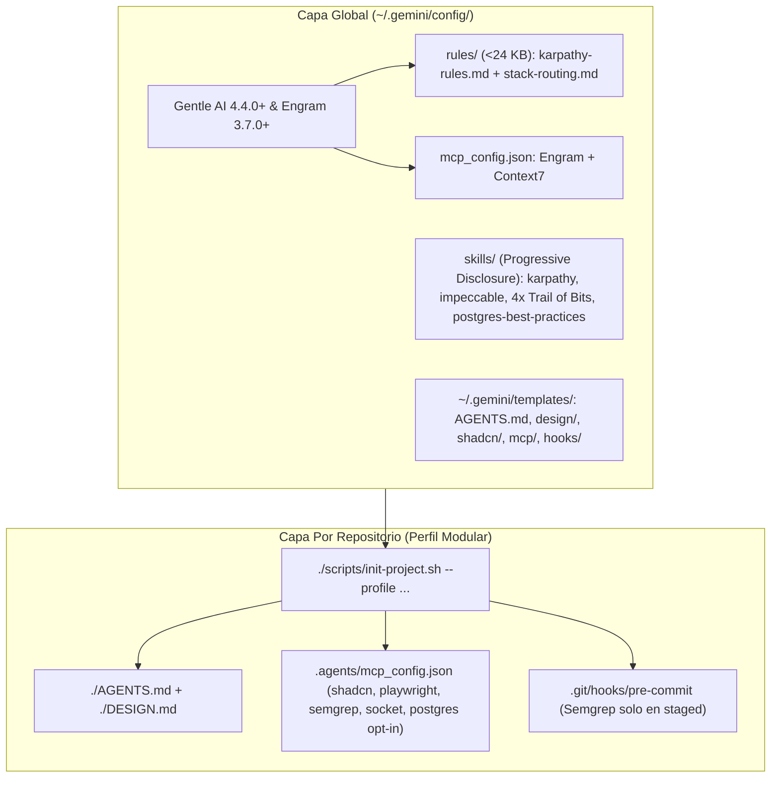

# Antigravity + Gentle AI + Karpathy Full-Stack

> **Production-grade agentic development framework for Google Antigravity, unifying Gentle AI (v4.4.0+) macro-orchestration, Andrej Karpathy's 4 operative coding pillars, UI craft & live browser verification, deterministic + logical security gates, and opt-in PostgreSQL guardrails.**

[](https://antigravity.google)
[](https://github.com/Gentleman-Programming/gentle-ai)
[](https://github.com/Gentleman-Programming/engram)
[](https://github.com/multica-ai/andrej-karpathy-skills)
[](LICENSE)

---

## 🎯 Por Qué Existe Este Repositorio

Al utilizar agentes de desarrollo autónomo como **Google Antigravity**, existen dos riesgos críticos que degradan el rendimiento:
1. **Truncamiento silencioso de reglas**: Antigravity impone un presupuesto estricto de **24 KB por archivo de reglas**. Las configuraciones monolíticas (como `GEMINI.md` de 80+ KB) descartan hasta el 72% de las instrucciones sin emitir advertencias visibles en consola.
2. **Vicios cognitivos de los LLMs**: Asunciones silenciosas sobre arquitectura, diffs invasivos (*drive-by refactoring*), diseño visual genérico (*AI slop*), dependencias inseguras y falta de verificación objetiva antes de cerrar tareas.

Este repositorio provee la **arquitectura unificada, modular y por capas**:
* **Capa 1 — Lógica y Disciplina**: **Gentle AI (v4.4.0+)** (Engram MCP, Context7, ODD/SDD, Judgment Day) + **Karpathy Guidelines**.
* **Capa 2 — Diseño UI y Verificación Visual**: `shadcn` MCP + registries curados por arquetipo, skill `impeccable` (*progressive disclosure*) y `@playwright/mcp` en headless.
* **Capa 3 — Seguridad Aplicativa y Supply-Chain**: Semgrep CLI + `semgrep mcp`, Socket MCP (`https://mcp.socket.dev/`), 4 skills quirúrgicas de `trailofbits/skills` (`differential-review`, `insecure-defaults`, `sharp-edges`, `fp-check`) y hook Git `pre-commit` sobre archivos *staged*.
* **Capa 4 — Base de Datos Opt-In**: skill `supabase-postgres-best-practices` y perfil opt-in `postgres-mcp` en modo `--access-mode=restricted` leyendo `DATABASE_URI` desde `.env` (gitignored).

---

## 🏗️ Arquitectura de Dos Capas (Global + Por Repositorio)



---

## 🚀 Flujo en 2 Pasos

### Paso 1: Bootstrap Global (1 comando por máquina)

Clona el repositorio y aprovisiona herramientas base, reglas `< 24 KB`, skills con *progressive disclosure* y plantillas en `~/.gemini/`:

```bash
git clone https://github.com/chili4/antigravity-gentle-karpathy-stack.git
cd antigravity-gentle-karpathy-stack
./scripts/setup-gentle-karpathy.sh
```

Flags opcionales disponibles:
- `--full` *(por defecto)*: instala todas las capas (core + frontend + seguridad + skill PostgreSQL).
- `--core-only`: instala únicamente Gentle AI + Karpathy core.
- `--no-frontend` / `--no-security` / `--no-db-skill`: omite capas específicas.

### Paso 2: Inicialización Por Proyecto (`init-project.sh`)

Prepara cualquier repositorio nuevo o existente sin contaminar otros proyectos. Escribe los servidores MCP del perfil en `<proyecto>/.agents/mcp_config.json` (y opcionalmente en `.mcp.json` para Claude Code con `--with-claude-mcp`) mediante **merge JSON no destructivo**:

```bash
# 1. Landing Page (UI + Playwright, sin gate pesado de seguridad salvo --with-security)
./scripts/init-project.sh --target ~/projects/mi-landing --profile landing

# 2. E-Commerce (UI + Playwright + Semgrep/Socket + hook pre-commit)
./scripts/init-project.sh --target ~/projects/mi-tienda --profile ecommerce --install-git-hook

# 3. ERP / Backoffice + PostgreSQL restricted + Claude MCP opcional
./scripts/init-project.sh --target ~/projects/mi-erp --profile erp --with-security --with-db --install-git-hook --with-claude-mcp
```

Perfiles soportados: `landing`, `ecommerce`, `erp`, `backend`, `fullstack`.

---

## 🛡️ Los 4 Pilares Operativos (Karpathy Guidelines)

| Pilar | Regla de Oro | Comportamiento Obligatorio |
| :--- | :--- | :--- |
| **1. Think Before Coding** | *Zero Silent Assumptions* | Detenerse y preguntar ante cualquier ambigüedad. Explicitar alternativas y trade-offs antes de tocar archivos. |
| **2. Simplicity First (KISS)** | *Minimum Code* | Cero código especulativo. Prohibidas clases, interfaces o fábricas para rutinas de uso único. |
| **3. Surgical Changes** | *Strict Diff Discipline* | Tocar **únicamente** las líneas pedidas. Prohibido reformatear código ajeno o borrar código muerto preexistente. |
| **4. Goal-Driven Execution** | *Verifiable Success Loop* | Todo cambio debe asociarse a un test observable (RED -> GREEN), verificación Playwright (UI) y cero hallazgos Semgrep (backend). |

---

## 📦 Contenido del Repositorio

* **`scripts/setup-gentle-karpathy.sh`**: Bootstrap global reproducible e idempotente (`--full`, `--core-only`, `--no-security`, `--no-frontend`).
* **`scripts/init-project.sh`**: Inicialización modular por proyecto (`AGENTS.md`, `DESIGN.md`, `shadcn` registries, merge no destructivo en `.agents/mcp_config.json`, `.env.example`/`.gitignore` y hook `pre-commit`).
* **`scripts/doctor.sh`**: Diagnóstico integral `[OK]` / `[WARN]` / `[FAIL]` del ecosistema global y de cualquier proyecto (`--project`).
* **`rules/karpathy-rules.md`** y **`rules/stack-routing.md`**: Reglas globales `always_on` (< 3 KB cada una, cumpliendo el límite de 24 KB).
* **`skills/karpathy-guidelines/`**: Skill global base con *progressive disclosure*.
* **`templates/`**: Contrato `AGENTS.md`, contratos visuales (`design/{landing,ecommerce,erp}.DESIGN.md`), presets `shadcn/`, fragmentos `mcp/` y `hooks/pre-commit-semgrep.sh`.
* **`examples/coupons/`**: Ejemplo de referencia ODD + TDD (RED/GREEN) + control de concurrencia (TOCTOU lock).

---

## 🔍 Diagnóstico del Entorno (`doctor.sh`)

Para verificar la salud completa del stack global (y opcionalmente un proyecto) en un comando:

```bash
# Diagnóstico global (versiones, cuota 24 KB, binarios, skills exactas, MCP JSON)
./scripts/doctor.sh

# Diagnóstico global + auditoría de un proyecto inicializado
./scripts/doctor.sh --project ~/projects/mi-erp
```

---

## 📄 Licencia

Distribuido bajo la licencia [MIT](LICENSE).
