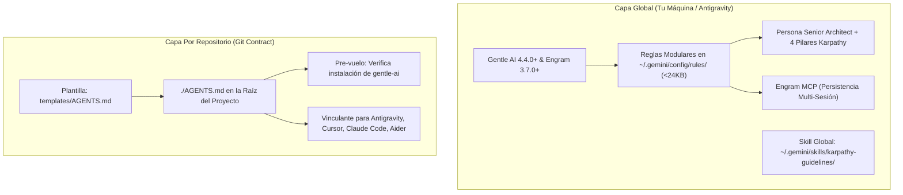

# Antigravity + Gentle AI + Karpathy Guidelines Stack

> **Production-grade agentic development framework for Google Antigravity, unifying Gentle AI (v4.4.0+) macro-orchestration with Andrej Karpathy's 4 operative coding pillars.**

[](https://antigravity.google)
[](https://github.com/Gentleman-Programming/gentle-ai)
[](https://github.com/Gentleman-Programming/engram)
[](https://github.com/multica-ai/andrej-karpathy-skills)
[](LICENSE)

---

## 🎯 Por Qué Existe Este Repositorio

Al utilizar agentes de desarrollo autónomo como **Google Antigravity**, existen dos riesgos críticos que degradan el rendimiento:
1. **Truncamiento silencioso de reglas**: Antigravity impone un presupuesto estricto de **24 KB por archivo de reglas**. Las configuraciones monolíticas (como `GEMINI.md` de 80+ KB) descartan hasta el 72% de las instrucciones sin emitir advertencias visibles en consola.
2. **Vicios cognitivos de los LLMs**: Asunciones silenciosas sobre arquitectura, diffs invasivos (*drive-by refactoring*), sobreingeniería prematura y falta de verificación objetiva antes de cerrar tareas.

Este repositorio provee la **arquitectura unificada y modular**:
* **Gentle AI (v4.4.0+)**: Resuelve la cuota de 24 KB dividiendo las directrices en reglas modulares, proveyendo memoria persistente a largo plazo (**Engram MCP**), orquestador **ODD / SDD**, y auditorías ciegas (**Judgment Day**).
* **Karpathy Guidelines**: Impone las 4 restricciones operativas de código a nivel de sistema prompt y contrato de proyecto.

---

## 🏗️ Arquitectura de Dos Capas (Global + Por Repositorio)



---

## 🚀 Instalación Rápida (1 Comando)

Para aprovisionar cualquier máquina Linux/macOS en segundos, clona el repositorio y ejecuta el script de bootstrapping:

```bash
git clone https://github.com/chili4/antigravity-gentle-karpathy-stack.git
cd antigravity-gentle-karpathy-stack
./scripts/setup-gentle-karpathy.sh
```

El script se encarga automáticamente de:
1. Instalar/actualizar `gentle-ai` a la versión `4.4.0+` y `engram` a `3.7.0+`.
2. Sincronizar el adaptador modular de Antigravity (`gentle-ai sync`).
3. Inyectar `karpathy-rules.md` (`always_on`) en `~/.gemini/config/rules/`.
4. Registrar la skill global `karpathy-guidelines` con *progressive disclosure*.
5. Instalar la plantilla `AGENTS.md` en `~/.gemini/templates/`.
6. Correr el health check con `gentle-ai doctor`.

---

## 🛡️ Los 4 Pilares Operativos (Karpathy Guidelines)

Cualquier agente que opere bajo este stack está estrictamente obligado por contrato a cumplir:

| Pilar | Regla de Oro | Comportamiento Obligatorio |
| :--- | :--- | :--- |
| **1. Think Before Coding** | *Zero Silent Assumptions* | Detenerse y preguntar ante cualquier ambigüedad. Explicitar alternativas y trade-offs antes de tocar archivos. |
| **2. Simplicity First (KISS)** | *Minimum Code* | Cero código especulativo. Prohibidas clases, interfaces o fábricas para rutinas de uso único. Si 50 líneas alcanzan, 200 es un defecto. |
| **3. Surgical Changes** | *Strict Diff Discipline* | Tocar **únicamente** las líneas pedidas. Prohibido reformatear código ajeno, reordenar imports o borrar código muerto preexistente. |
| **4. Goal-Driven Execution** | *Verifiable Success Loop* | Todo cambio debe asociarse a un test observable. En bugs: reproducir el fallo primero (RED), aplicar fix mínimo, y verificar (GREEN). |

---

## 📦 Contenido del Repositorio

* **`scripts/setup-gentle-karpathy.sh`**: Script reproducible y multiplataforma de aprovisionamiento global.
* **`templates/AGENTS.md`**: Plantilla de contrato lista para copiar a cualquier proyecto nuevo (`cp templates/AGENTS.md <mi-proyecto>/AGENTS.md`). Incluye pre-vuelo obligatorio de herramientas.
* **`rules/karpathy-rules.md`**: Archivo de regla global de Antigravity (`trigger: always_on`, 2.0 KB).
* **`skills/karpathy-guidelines/`**: Skill compatible con Antigravity para consulta contextual.
* **`examples/coupons/`**: Ejemplo completo verificado en producción con ODD, TDD (RED/GREEN), control de concurrencia contra race conditions (TOCTOU lock) y suite de pruebas unitarias.

---

## 🔍 Verificación del Entorno

Para verificar la salud del ecosistema en cualquier momento:

```bash
# 1. Comprobar salud general de Gentle AI y MCP
gentle-ai doctor

# 2. Verificar que ningún archivo de regla supere los 24 KB
find ~/.gemini/config/rules -size +24k

# 3. Refrescar el registro de skills del proyecto
gentle-ai skill-registry refresh
```

---

## 📄 Licencia

Distribuido bajo la licencia [MIT](LICENSE).
